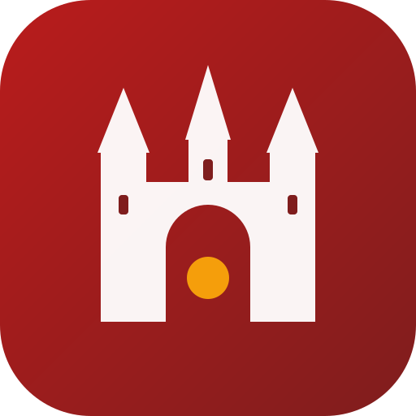

<div align="center">
  
  
  # rothenburg.digital
  
  **Offene Daten für Rothenburg ob der Tauber – geprüft, ergänzt, anschlussfähig.**
  
  *Ein Proof of Concept des OK Lab Rothenburg (in Gründung) – eine Initiative von Alexander Schnapper.*
  
  [](https://rothenburg.digital/)
  [](./LICENSE)
  [](https://www.w3.org/WAI/WCAG22/quickref/)
  [-0284c7?style=flat-square)](https://github.com/alexschnapper/rothenburg-digital/milestones)
</div>

---

### 🧪 Über das Projekt

**rothenburg.digital** ist ein zivilgesellschaftliches Civic-Tech-Projekt des **OK Lab Rothenburg (in Gründung)**, initiiert und entwickelt von Alexander Schnapper. Es kümmert sich um die Grundlage, ohne die keine digitale Anwendung seriös sein kann: **eine belastbare Datenbasis.**

Das Projekt ist bewusst **keine weitere Insel-Plattform**. Es arbeitet den bestehenden Systemen und Anbietern zu:

* **🔎 Datenlage sichtbar machen:** Alle offenen Datensätze der Stadt werden regelmäßig und automatisch geprüft – auf Vollständigkeit, Aktualität, Lizenzen und Plausibilität. Die Befunde sind öffentlich und gehen als sachliche Rückmeldung an die Datenhalter.
* **🔌 Daten zurückgeben:** Was hier aufbereitet wird (geprüfte Koordinaten, lesbare Öffnungszeiten, saubere Adressen), steht in offenen Standardformaten bereit, damit bestehende Systeme es übernehmen können – etwa den **RTS-Graph** des Rothenburg Tourismus Service (RTS) (Social Knowledge Graph), **Land.Open.Data** oder Tourismus-Plattformen.
* **📡 Empirie schaffen, wo sie fehlt:** Wo es keine Daten gibt, erprobt das OK Lab Rothenburg (in Gründung) offene LoRaWAN-Sensorik – offen, nachbaubar und übertragbar auf andere Kommunen.

Das Projekt entsteht zu **100 % quelloffen (GPLv3)**, DSGVO-konform und wird auf unabhängigen Servern in Deutschland betrieben.

🔗 **Website:** [https://rothenburg.digital/](https://rothenburg.digital/)

> **Rollenabgrenzung:** rothenburg.digital ist keine offizielle Tourismusseite und keine Konkurrenz zu [rothenburg-tourismus.de](https://www.rothenburg-tourismus.de/). Als unabhängige Initiative für das OK Lab Rothenburg (in Gründung) testen wir neue, offene Schnittstellen und Datenformate (u. a. für Land.Open.Data), um Barrierearmut, Hitzeschutz und urbane Sensorik praxistauglich zu machen.

---

### 🌟 Schwerpunkte

* **📊 Offene Daten & Datenqualität**
  * Angebunden sind die offenen Daten der Stadt über [bydata](https://rothenburg.bydata.de/): Parkplätze und E-Ladesäulen, Restaurants, Sehenswürdigkeiten, Einkaufen, Defibrillatoren und Hitzeorte – jeweils mit Lizenz und Quelle je Datensatz.
  * Die Daten stammen aus dem Projekt **RTS-Graph** des Rothenburg Tourismus Service (RTS), gefördert vom Bund. rothenburg.digital baut darauf auf und ergänzt es: prüfen, aufbereiten, zurückgeben.
  * Begriffe: Ein **Datensatz** ist eine Sammlung im Portal, etwa „Restaurants“ (die Stadt hat 18). Jeder Datensatz enthält viele **Einträge**, also einzelne Orte oder Angebote.
  * Wöchentlicher, automatischer Bericht zur Datenqualität aller Datensätze, öffentlich auf der Seite `/daten` und in [`docs/datenqualitaet.md`](./docs/datenqualitaet.md) ([#80](https://github.com/alexschnapper/rothenburg-digital/issues/80)). Wie die Daten fließen und was wo geprüft wird, zeigt [`docs/datenfluss.md`](./docs/datenfluss.md).
  * Die aufbereiteten Daten zum Weiterverwenden ([#81](https://github.com/alexschnapper/rothenburg-digital/issues/81)): GeoJSON je Bereich (`/daten/parken.geojson`, `/daten/notfall-hitze.geojson`, `/daten/essen-trinken.geojson`, `/daten/einkaufen.geojson`, `/daten/sehenswuerdigkeiten.geojson`), Termine zum Abonnieren als Kalender (`/daten/termine.ics`, dazu `/daten/termine.geojson`, [#36](https://github.com/alexschnapper/rothenburg-digital/issues/36)), ein DCAT-AP-Katalog (`/daten/katalog.jsonld`) und schema.org-Angaben auf den Bereichsseiten. Lizenz und Quelle stehen an jedem Eintrag; mischt ein Feed Datensätze, gilt die strengste Lizenz (CC BY-SA 4.0 bei Einkaufen).
  * Angefragt: offizieller Zugang zum Ratsinformationssystem (OParl) und zu Veranstaltungsdaten.
* **📡 Urbane Sensorik & Klima**
  * LoRaWAN-Messnetze für Bodenfeuchte und Stadtklima (geplant, siehe [Pilot-Stränge](#-pilot-stränge-2027)).
  * Geplant: amtliche Luftqualitätswerte des Umweltbundesamts, ergänzt um einen lokalen Sensor ([Sensor.Community](https://sensor.community/)) als Richtwert.
* **♿ Echte Inklusion**
  * WCAG AAA als Maßstab für alle Oberflächen: höchste Kontraste, vollständige Tastatur- und Screenreader-Bedienung.
  * 1-Klick-Umschalter für **Einfache Sprache** (kurze Sätze, bekannte Wörter).
  * Geplant: stufenfreie Wege auf dem Altstadt-Pflaster und reizarme Rückzugsorte (Neurodivergenz/Sensory-Friendly). Dafür fehlen bisher offene Daten; eingebunden werden sie, sobald es sie gibt, etwa aus der Arbeit von Inklusionsbeirat und Bauamt zur Barrierearmut.
* **🔒 Souveränität**
  * 100 % Open Source (GPLv3), DSGVO-konform, EU-gehostetes Sprachmodell.
  * Offene Formate und Schnittstellen statt geschlossener Datensilos.
* **💬 Chat als Demonstrator:** Ein barrierefreier, mehrsprachiger Chat zeigt, wie sich geprüfte offene Daten verständlich abfragen lassen – mit Quelle und Lizenz zu jeder Angabe. Er ist ein Beispiel für Anwendungen, die auf einer sauberen Datenbasis aufbauen können, kein eigenständiges Produkt.

---

### 🌱 Pilot-Stränge 2027

Geplante Piloten im Rahmen des OK Lab Rothenburg (in Gründung) – noch nicht umgesetzt:

1. **🌳 Baum-Sensorik & Stadtgärtnerei (Bodenfeuchte / Gieß-Dashboard)**
   * **Ziel:** Trockenstress an städtischen Jungbäumen sichtbar machen und Bewässerungsfahrten optimieren – nach Vorbildern wie *Gieß den Kiez* (Berlin) oder Projekten in Leipzig und Stuttgart.
   * **Technik:** Kapazitive Bodenfeuchte- und Temperatursensoren per LoRaWAN im Wurzelbereich ausgewählter Stadtbäume.
   * **Mehrwert:** Greifbarer Nutzen für Klimaschutzmanagement und Stadtgärtnerei; anschaulich für Bürgerschaft und Gremien.
2. **🌡️ Mikroklima & Hitze-Hotspots (DIY-Umweltsensoren)**
   * **Ziel:** Das reale Mikroklima der engen, versiegelten Altstadt mit Kaltluftkorridoren (Burggarten, Taubertal) vergleichen.
   * **Technik:** Sensor.Community-Hardware (z. B. ESP32/ESP8266 mit BME280 für Temperatur/Luftfeuchte, SPS30/SDS011 für Feinstaub) oder LoRaWAN-Wetterstationen.
   * **Mehrwert:** Datenbasis für Hitzeschutzmaßnahmen und eine spätere „Cool-Route“ für Einheimische und Gäste.
3. **🅿️ Test-Parkraumerfassung (Besucherlenkung vor der Stadtmauer)**
   * **Ziel:** Prototypische Belegungserkennung ausgewählter Parkflächen (z. B. P1–P5), um Verkehrsströme früh zu lenken und Parksuchverkehr in den Gassen zu verringern.
   * **Technik:** LoRaWAN-Bodensensoren (geomagnetisch/Radar, mehrjähriger Batteriebetrieb) auf wenigen Test-Stellplätzen – oder optische Zählung an Ein-/Ausfahrt mit lokaler Edge-KI, DSGVO-konform ohne Kennzeichen-Speicherung.
   * **Mehrwert:** Hohe Relevanz für Besucherlenkung und Verkehrsüberwachung bei Großevents und zu Stoßzeiten.

#### 📶 Das Rückgrat: offenes LoRaWAN mit The Things Network

Da es noch keine Sensor-Infrastruktur gibt, ist der Aufbau eines offenen LoRaWAN-Netzes der erste Schritt:

* **Offen & bürgernah:** Einbindung in [The Things Network (TTN)](https://www.thethingsnetwork.org/) – so können Bürgerinnen und Bürger, Schulen oder Gewerbetreibende eigene Sensoren ohne Zusatzkosten einbinden.
* **Hardware-Bedarf:** 1–2 Outdoor-Gateways (z. B. MikroTik wAP LR8 oder RAK Wireless) an erhöhten Punkten (z. B. nahe der Stadtmauer oder auf einem privaten Dach) decken oft schon weite Teile der Altstadt und der Parkflächen ab.

---

### 🗺️ Roadmap & Meilensteine

Fortschritt und Details in den [Milestones](https://github.com/alexschnapper/rothenburg-digital/milestones) — jeder Punkt hängt an einem Issue.

* **Bisher erreicht** (Pre-Releases bis [`v0.3.2-alpha`](https://github.com/alexschnapper/rothenburg-digital/releases), 06.11.2026):
  * *Grundlage:* Prototyp mit EU-Modell und Missbrauchs-Abwehr, offene Daten der Stadt als Seiten und im Chat (Parken & E-Laden, Essen & Trinken, Sehenswürdigkeiten, Einkaufen, Notfall & Hitze), Lizenz je Datensatz, Einfache Sprache.
  * *`v0.2-beta` – Datenlage sichtbar machen:* Bestandsaufnahme aller Datensätze ([#66](https://github.com/alexschnapper/rothenburg-digital/issues/66)), wöchentlicher Bericht zur Datenqualität mit Dashboard ([#80](https://github.com/alexschnapper/rothenburg-digital/issues/80), [#84](https://github.com/alexschnapper/rothenburg-digital/issues/84)).
  * *`v0.3-beta` – Daten zurückgeben:* aufbereitete Daten als offene Feeds ([#81](https://github.com/alexschnapper/rothenburg-digital/issues/81)), Termine als Kalender und GeoJSON ([#36](https://github.com/alexschnapper/rothenburg-digital/issues/36)), DCAT-AP-Katalog offiziell geprüft ([#107](https://github.com/alexschnapper/rothenburg-digital/issues/107)).
  * *Auf dem Weg zu v1.0:* offene Daten zuerst auf Start- und Infoseite ([#82](https://github.com/alexschnapper/rothenburg-digital/issues/82)), einheitliches Erscheinungsbild mit AAA-Prüfung ([#119](https://github.com/alexschnapper/rothenburg-digital/issues/119)), zentrale Projektangaben ([#115](https://github.com/alexschnapper/rothenburg-digital/issues/115)).
* **`v1.0-release`** (Ende Februar 2027) – *Öffentlicher Start:* Meldeweg für Datenfehler ([#10](https://github.com/alexschnapper/rothenburg-digital/issues/10)), Presse und Vorträge ([#111](https://github.com/alexschnapper/rothenburg-digital/issues/111)). Der Chat bleibt Demonstrator und lässt sich je Umgebung abschalten ([#109](https://github.com/alexschnapper/rothenburg-digital/issues/109), später).
* **Später** ([Future ideas](https://github.com/alexschnapper/rothenburg-digital/milestone/5)): amtliche Luftqualität ([#5](https://github.com/alexschnapper/rothenburg-digital/issues/5)), offizieller Zugang zum Ratsinformationssystem ([#30](https://github.com/alexschnapper/rothenburg-digital/issues/30)), Termine von Partnerseiten ([#117](https://github.com/alexschnapper/rothenburg-digital/issues/117)).
* **Sensorik-Pilot 2027:** offenes LoRaWAN und erste Sensoren ([#73](https://github.com/alexschnapper/rothenburg-digital/issues/73)), siehe [Pilot-Stränge](#-pilot-stränge-2027).

---

### 🛠️ Tech-Stack

* **Framework:** Next.js (App Router, PWA)
* **AI / Orchestrierung:** Vercel AI SDK (DSGVO-konforme EU-Modelle / Mistral AI)
* **Design & A11y:** Tailwind CSS, Semantic HTML, Screenreader-optimiert, Ausrichtung auf WCAG AAA
* **Sensorik (geplant):** LoRaWAN über The Things Network, Sensor.Community-Hardware, Edge-Auswertung
* **Hosting:** Unabhängiger Linux VPS mit Plesk (Nginx / Node.js Runtime) in Deutschland

---

### 🧑‍💻 Entwicklung

Entwickelt wird auf `dev`; `main` trägt den veröffentlichten Stand.

```bash
npm install
cp .env.example .env.local   # MISTRAL_API_KEY eintragen
npm run dev                  # http://localhost:3000
```

* **Lokal starten, Feature-Flags, Projektstruktur:** [`docs/ENTWICKLUNG.md`](./docs/ENTWICKLUNG.md)
* **Umgebungsvariablen & Deployment (Plesk/Passenger):** [`docs/DEPLOYMENT.md`](./docs/DEPLOYMENT.md)

---

### 🤝 Mitmachen & Feedback

Das OK Lab Rothenburg (in Gründung) lebt vom Mitmachen. Wir freuen uns über Mitwirkende, Ideen und Anregungen aus der Bürgerschaft, von lokalen Initiativen, Schulen und Open-Source-Begeisterten – ob mit Code, Sensor- oder Gateway-Standorten oder Rückmeldungen zur Barrierefreiheit:

* 💡 **Ideen einreichen:** Erstelle gerne ein [GitHub Issue](https://github.com/alexschnapper/rothenburg-digital/issues) mit dem Label `community-proposal`.
* 🐛 **Fehler melden:** Bitte über den [Issue-Tracker](https://github.com/alexschnapper/rothenburg-digital/issues) erfassen.
* 📰 **Presse und Vorträge:** Medienberichte, Auftritte und Material für Presse und Veranstalter in [`docs/presse.md`](./docs/presse.md).

---

### ⚖️ Disclaimer & Lizenz

rothenburg.digital ist ein Proof of Concept des OK Lab Rothenburg (in Gründung) – eine unabhängige Open-Source-Initiative, konzipiert und entwickelt von **Alexander Schnapper**.  
*Kein offizielles Angebot der Stadt Rothenburg ob der Tauber oder des Rothenburg Tourismus Service (RTS) – offen für Dialog und Kooperation.*

Der Quellcode ist lizenziert unter der [GNU General Public License v3.0 (GPLv3)](./LICENSE).
Die Daten in den Feeds unter `/daten/…` stehen nicht unter der GPLv3, sondern unter der Lizenz ihres Quelldatensatzes der Stadt (CC0, CC BY 4.0 oder CC BY-SA 4.0, angegeben in jeder Datei).
