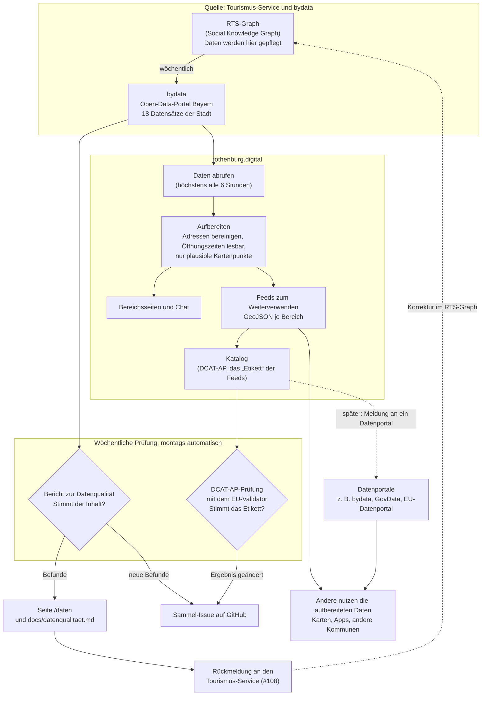

# Datenfluss und Prüfungen

Wo die offenen Daten herkommen, was rothenburg.digital damit macht und was wo geprüft wird. Für Menschen ohne Technikhintergrund zuerst die Kurzfassung, darunter das Bild.

## Kurzfassung

- **Die Daten pflegt der Tourismus-Service** im RTS-Graph (Social Knowledge Graph). Das bayerische Open-Data-Portal bydata holt sie von dort einmal pro Woche ab und veröffentlicht sie.
- **rothenburg.digital liest die Daten bei bydata** und ändert dort nichts. Korrekturen an den Daten selbst passieren immer im RTS-Graph.
- **Zwei Prüfungen, zwei Fragen:**
  - **Bericht zur Datenqualität (#80):** Stimmt der *Inhalt*? Etwa: Liegt ein Laden am richtigen Kartenpunkt, sind Öffnungszeiten lesbar, ist der Datensatz aktuell? Die Befunde gehen als Rückmeldung an den Tourismus-Service (#108).
  - **DCAT-AP-Prüfung (#107):** Stimmt das *Etikett*? Unser Katalog beschreibt die aufbereiteten Daten nach einer EU-Norm, damit Datenportale sie automatisch finden. Geprüft wird er mit dem Prüfwerkzeug der EU.
- **Beide laufen automatisch einmal pro Woche**, montags früh. Gemeldet wird nur, was sich gegenüber der Vorwoche geändert hat.
- **Gespeichert wird bei rothenburg.digital nur das Prüfergebnis**, nicht die Daten. Die aufbereiteten Daten entstehen bei jedem Abruf neu aus dem aktuellen Stand bei bydata.

## Mermaid Diagram

Ein Mermaid-Diagramm stellt Abläufe, Beziehungen oder Strukturen als visuelles Diagramm dar, das aus einer einfachen, Markdown-inspirierten Textbeschreibung erstellt wird.

Durchgezogene Pfeile laufen heute automatisch. Gestrichelte Pfeile sind Schritte, die Menschen anstoßen: die Korrektur im RTS-Graph und die Meldung des Katalogs an ein Datenportal.

## Was wo liegt

| Schritt | Wie oft | Ergebnis | Technik |
|---|---|---|---|
| Daten abrufen | bei Bedarf, höchstens alle 6 Stunden | nichts gespeichert, nur zwischengespeichert | `src/lib/opendata/bydata.ts` |
| Aufbereiten | bei jedem Abruf | Seiten, Chat, Feeds | `src/lib/opendata/*.ts`, `feeds.ts` |
| Bericht zur Datenqualität | montags automatisch, sonst `npm run datenqualitaet` | `/daten`, `docs/datenqualitaet.md`, `reports/datenqualitaet.json` | `scripts/datenqualitaet.mts` |
| DCAT-AP-Prüfung | montags automatisch, sonst `npm run dcat:pruefen` | `reports/dcat-ap.json` | `scripts/dcat-pruefen.mts` |
| Meldung | nur bei Änderung gegenüber der Vorwoche | Kommentar im Sammel-Issue (Label `datenqualitaet`) | `.github/workflows/datenqualitaet.yml` |
